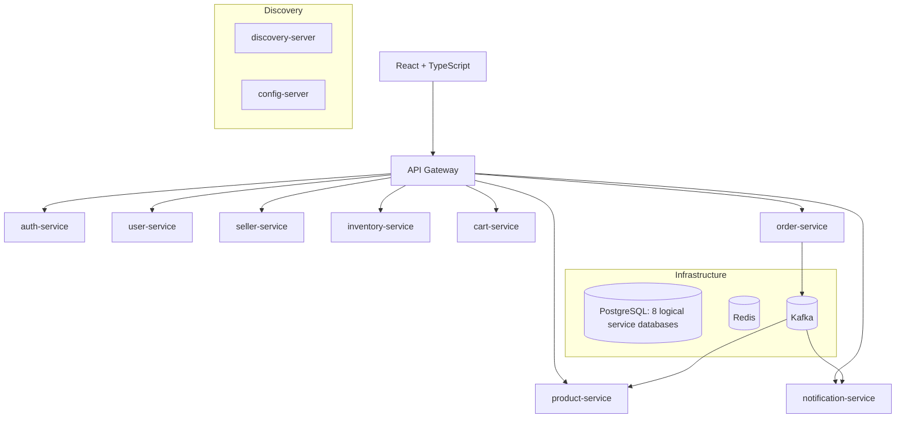

# Kiến trúc tham chiếu Smart E-Commerce Marketplace V2

Nguồn: báo cáo phân tích thiết kế V2, chương 6–9. **Đây là bộ khung**, chưa là xác nhận source hiện tại triển khai tất cả thành phần.

Tất cả service sở hữu database riêng về mặt logic; **không tạo foreign key xuyên database**. `order-service` phối hợp `cart`, `product`, `seller` và `inventory` qua HTTP nội bộ, trạng thái đơn được bù trừ theo Saga. Sự kiện nghiệp vụ của Order qua transactional outbox/Kafka; xem [RUN_LOCAL.md](RUN_LOCAL.md#hạ-tầng).

## Vùng dùng chung cần review

- `order-service`: TV3 checkout, TV4 fulfillment/COD, TV5 finance.
- `product-service`: TV2 product/catalog, TV5 review.
- `frontend/src/app` và `frontend/src/shared`: TV1 chịu trách nhiệm.
- API/event/Flyway phải thống nhất contract và cập nhật test bên gọi/nhận.

Xem [OWNERSHIP.md](OWNERSHIP.md), [CONTRACTS.md](CONTRACTS.md), [DEVELOPMENT.md](DEVELOPMENT.md).
