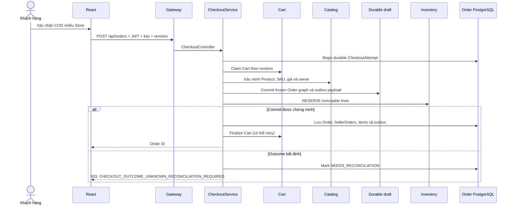
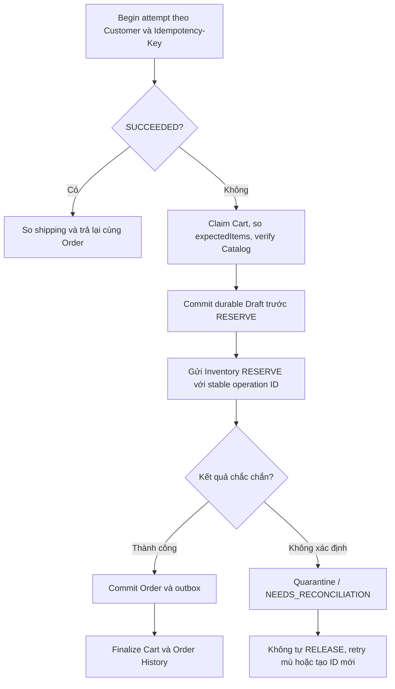
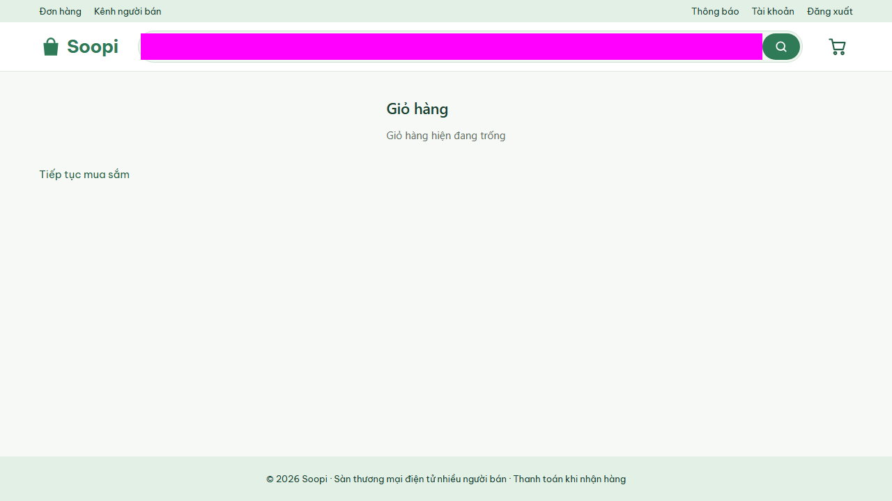

# TV3 — Cart, Checkout COD và Order đa cửa hàng

**Trạng thái:** REVIEW CANDIDATE, tái dựng từ [bản nháp TV3 trên Issue #160](https://github.com/duyxl56785/Project_HK5/issues/160#issuecomment-6702448960) và đối chiếu code main@78de5c08205b41986a5204a8150a9ef810507847. Không phải bản sao file 351 dòng của Codex; chưa được TV2 duyệt vào báo cáo cuối. Không sửa ứng dụng.

### 1. Mục tiêu và phạm vi chức năng

Checkout được xây dựng cho sàn thương mại điện tử nhiều cửa hàng, hỗ trợ thanh toán **COD (Cash On Delivery)**. Một khách hàng có thể đưa sản phẩm từ nhiều Store vào cùng giỏ, kiểm tra lại giá/khả dụng và gửi **một** lệnh đặt hàng; hệ thống sinh một đơn tổng (`Order`/`MarketplaceOrder`) gắn nhiều đơn con (`SellerOrder`) theo Store. Mỗi đơn lưu snapshot sản phẩm, số lượng, đơn giá và khoản tiền tại thời điểm tạo. Website hiện chưa tích hợp thanh toán online, hoàn tiền tự động hay hợp đồng Finance production đã được phê duyệt.

### 2. Công nghệ và kiến trúc

Frontend React/TypeScript cung cấp Cart, Checkout COD và Order History. Backend gồm API Gateway, `cart-service`, `order-service`, Catalog/Product và Inventory tương tác qua adapter HTTP có kiểm tra authority/DTO; dữ liệu bền vững của giỏ/đơn/lệnh được lưu bằng PostgreSQL16, JPA/JDBC và Flyway. Java 21, Spring Boot, Gradle và Testcontainers dùng cho triển khai/kiểm thử. Luồng nghiệp vụ:

`React Cart → Gateway → Cart API (revision, items)`

`React Checkout → POST /api/orders → Idempotency/Order → Cart claim → Catalog verify → durable CheckoutDraft/Inventory intent → Inventory RESERVE → Order + SellerOrders + outbox commit → Cart finalize → Order History`

Đây là **luồng thiết kế và source thực tế**, không phải lời khẳng định các phụ thuộc bên ngoài đều chạy ổn định trong mọi lỗi mạng.

Nguồn:
- [CheckoutController](https://github.com/duyxl56785/Project_HK5/blob/78de5c08205b41986a5204a8150a9ef810507847/backend/order-service/src/main/java/com/projecthk5/orderservice/api/CheckoutController.java)
- [CheckoutService](https://github.com/duyxl56785/Project_HK5/blob/78de5c08205b41986a5204a8150a9ef810507847/backend/order-service/src/main/java/com/projecthk5/orderservice/service/CheckoutService.java)
- [CartController](https://github.com/duyxl56785/Project_HK5/blob/78de5c08205b41986a5204a8150a9ef810507847/backend/cart-service/src/main/java/com/projecthk5/cartservice/api/CartController.java)
- [CheckoutCodView React](https://github.com/duyxl56785/Project_HK5/blob/78de5c08205b41986a5204a8150a9ef810507847/frontend/src/features/checkout/CheckoutCodView.tsx)

**Sơ đồ 1 — Checkout và ranh giới hệ thống (mô tả code, không phải log thực thi):**

**Sơ đồ 2 — Idempotency, rollback và UNKNOWN:**

### 3. Diễn giải luồng xử lý Checkout theo source

**Bước 1 — Quản lý giỏ và xác thực khách hàng.** `GET /api/cart`, `POST /api/cart/items`, `PATCH /api/cart/items/{productId}`, `DELETE /api/cart/items/{productId}`, `DELETE /api/cart` phục vụ xem/thêm/sửa/xóa/clear giỏ. Customer được xác định từ JWT đã xác thực; giỏ phân nhóm Store, duy trì revision để phát hiện bản cũ.

**Bước 2 — Gửi lệnh tạo đơn COD.** React gọi `POST /api/orders` kèm JWT, header `Idempotency-Key` và JSON có `expectedRevision`, `expectedItems` và `shipping`. Controller chuẩn hóa địa chỉ giao hàng rồi giao `CheckoutService` xử lý. Server kiểm tra key 1–128 ký tự và cấu trúc expectedItems, tính fingerprint để chống đổi payload khi replay.

**Bước 3 — Nhận quyền xử lý lần đặt hàng.** `IdempotencyCoordinator.begin(customerId,key,fingerprint)` tạo hoặc đọc CheckoutAttempt bền vững. Khi attempt đã `SUCCEEDED`, server đọc lại Order theo customer, so cả shipping, trả về Order cũ, không tạo Order/Inventory RESERVE mới; thay key/body không trở thành giao dịch mới một cách âm thầm. Trạng thái chưa xác định cần reconciliation, không coi là chắc chắn thất bại.

**Bước 4 — Đối chiếu giỏ với dữ liệu hiện hành.** `CartPort.claim` dùng key và revision để chống hai Checkout cùng giỏ. Server so `expectedItems` với snapshot Cart; qua Catalog kiểm tra Product, Seller→Store, SKU, giá, quantity, tính tiền bằng `BigDecimal` và kiểm tra giá/giới hạn lưu trữ. Nếu Product bị khóa/thiếu, Store không hợp lệ, stale revision hay giá thay đổi thì yêu cầu bị từ chối với lý do phù hợp, không lặng lẽ loại bỏ một món khỏi giỏ.

**Bước 5 — Chuẩn bị bản nháp bền vững và dự trữ tồn kho.** Order tổng, SellerOrders và items được gán ID ổn định, snapshot tiền, shipping và outbox payload trước lần gọi Inventory. `CheckoutDraftJournal` lưu graph qua transaction riêng; Inventory `RESERVE` được gửi dựa trên Product/SKU và quantity đã kiểm chứng, không sử dụng map Product↔SKU không đáng tin từ client.

**Bước 6 — Commit Order và xác nhận kết quả.** Khi Inventory trả kết quả thành công và Order writer commit, lưu đơn tổng/đơn con/outbox, thử finalize Cart và trả Order ID. Nếu kết quả trả về từ Cart/Inventory/DB không xác định vì timeout/lost response, attempt được giữ để đối soát (`CHECKOUT_OUTCOME_UNKNOWN_RECONCILIATION_REQUIRED`); không tạo operation ID mới, không tự RELEASE hoặc trừ kho thêm khi chưa chứng minh được tác động thật.

**Bước 7 — Tra cứu.** `GET /api/orders` và `GET /api/orders/{orderId}` chỉ cung cấp Order của khách tương ứng; giao diện Order History hiển thị đơn, các đơn con và trạng thái.

Nguồn bổ sung: [OrderController](https://github.com/duyxl56785/Project_HK5/blob/78de5c08205b41986a5204a8150a9ef810507847/backend/order-service/src/main/java/com/projecthk5/orderservice/api/OrderController.java), [CheckoutDraftJournal](https://github.com/duyxl56785/Project_HK5/blob/78de5c08205b41986a5204a8150a9ef810507847/backend/order-service/src/main/java/com/projecthk5/orderservice/service/CheckoutDraftJournal.java).

### 4. Các cơ chế bảo đảm tính đúng đắn

- **Idempotency:** `(customerId,Idempotency-Key)` chống trùng key; cùng key và payload hợp lệ trả kết quả đã commit, đổi payload/shipping trả lỗi, không tạo thêm đơn.
- **Consistency:** Cart revision + expectedItems + Catalog preflight tránh xác nhận nhầm sản phẩm/giá; Seller→Store phải nhất quán; snapshot của Order không được tự động cập nhật theo Catalog sau khi chốt.
- **Inventory safety:** có journal/intent bất biến trước external call; xử lý timeout theo `UNKNOWN/NEEDS_RECONCILIATION` thay vì bù trừ mù; không khẳng định đã nghiệm thu đầy đủ hai fixture fault thật.
- **Ownership:** chỉ Customer gốc được checkout/đọc Order theo JWT; fulfillment của từng SellerOrder vẫn theo Seller/Store owner và phân quyền Gateway/backend.
- **Tiền:** tính bằng `BigDecimal` và kiểm tra giới hạn lưu trữ, không dùng float tùy tiện; quy tắc chính sách tiền COD/Finance production (`M01`) vẫn là gate phê duyệt riêng.

### 5. Kiểm thử và kết quả đã có bằng chứng

| Nội dung | Kết quả | Phạm vi/chứng cứ |
| --- | --- | --- |
| Multi-Store COD Checkout | **PASS demo lịch sử, không phải final UAT** | TV3 HTTP/SQL tại [#145](https://github.com/duyxl56785/Project_HK5/pull/145); TV2 báo 10 ca tại [#147](https://github.com/duyxl56785/Project_HK5/pull/147), raw receipt riêng của 10 ca vẫn chưa được đối chiếu |
| One Order + 2 SellerOrders, snapshot tiền | **PASS demo đã ghi** | TV3 frozen SQL Order/SellerOrder/Item snapshots trên app `bf8eb3a`; không gộp với browser History từ HEAD khác thành một lượt UAT duy nhất |
| Same-key replay, thay key/body, giá đổi/hết hàng, revision/Product | **PASS trong các case đã chạy** | TV3 6/6 negative Gateway/API tại #145, TV2 owner [10-case final #147](https://github.com/duyxl56785/Project_HK5/pull/147); source integrated main |
| Order History | **PASS trong demo** | TV2 browser/HTTP History snapshot tại #147, có test UI tích hợp; không thay cho final UAT |
| CI mới tại HEAD PR #187 (chưa merge) | **3/3 SUCCESS** | [PR #187](https://github.com/duyxl56785/Project_HK5/pull/187) `bc824863`: Hosted PostgreSQL16 **140/140 PASS**, frontend **166/166 PASS**, Playwright qua Gateway cô lập **20/20 PASS**. Đây là SHA PR, **không phải final UAT trên main**. |
| UNKNOWN claim-conflict thật | **BLOCKED_DESIGN** | Chưa có legitimate fixture/provider COMMIT receipt; không dùng mock làm real contention |
| UNKNOWN timeout/lost-response thật | **NOT_RUN / BLOCKED_OWNER** | [#170](https://github.com/duyxl56785/Project_HK5/pull/170) mới là preparation; thiếu case-level approval, full tuple và read-only provider oracle |
| Final UAT 2 Seller / 2 Store / 1 Customer / 1 Admin, Finance production | **NOT ACCEPTED** | TV5 [#18](https://github.com/duyxl56785/Project_HK5/issues/18) OPEN; M01, grants/retention và các owner approvals còn độc lập |

**Nhận định:** TV3 đã hoàn thành mã nguồn Checkout COD/Cart/Order/Order History và kiểm chứng chức năng demo nhiều cửa hàng với evidence/CI đã ghi nhận. Chưa có cơ sở để tuyên bố full production readiness hoặc failover/UNKNOWN/Finance UAT cuối. Khi làm video demo cần quay màn hình giỏ 2 Store, xác nhận COD, Order ID + 2 SellerOrders, Order History và tình huống lỗi; dẫn evidence SQL/log thực thay vì số PASS ước lượng.

### 6. Media demo: ảnh thật sẵn có và ảnh chưa có

**Ảnh đã được lưu trên GitHub, thuộc website smoke test Cart hai Store ngày 06/11/2026:**

*Nguồn gốc: [artifact tại main đã kiểm tra](https://github.com/duyxl56785/Project_HK5/blob/78de5c08205b41986a5204a8150a9ef810507847/reports/minh-chung-kiem-thu/soopi-audit-20261106/website-extended/cart-hai-store-quantity-remove-va-jwt-het-han-passed.png). Ảnh chỉ chứng minh tình huống Cart trong bộ test được lưu, **không chứng minh giao dịch Checkout đã hoàn tất hay UAT cuối PASS**.*

**Các ảnh còn cần quay/chụp từ stack thật (chưa có artifact Checkout tương ứng trong repo tại SHA đã rà):** Cart 2 Store trước đặt hàng, màn hình xác nhận COD và Order ID sau đặt, Order History hiện 2 SellerOrders, snapshot PostgreSQL/Inventory receipt đã xóa token/PII, và trường hợp stale revision/hết hàng. Mỗi ảnh/clip mới cần exact source SHA, testcase, timestamp, tên stack, hash và mô tả dữ liệu giả. Không dựng UI giả làm evidence.

### 7. Kịch bản thuyết trình Checkout — 5 phút

- **0:00–0:45:** Bài toán 1 Cart/2 Store → 1 root Order và 2 SellerOrders; thanh toán COD.
- **0:45–1:40:** Kiến trúc React, Gateway, Cart, Catalog, Order, Inventory và PostgreSQL/Flyway.
- **1:40–2:35:** POST /api/orders với `Idempotency-Key`, `expectedItems`, `expectedRevision` và `shipping`, sau đó Cart claim và Catalog preflight.
- **2:35–3:35:** Giải thích freeze Order IDs, BigDecimal, durable draft trước Inventory RESERVE, transaction commit/outbox; mất response thì quarantine.
- **3:35–4:30:** Dẫn evidence đúng SHA: #145/#147 là lịch sử; PR #187 hosted PG 140, frontend 166, E2E 20 trên **nhánh PR**, không phải final UAT.
- **4:30–5:00:** Nêu rõ chỗ chưa nghiệm thu: live UNKNOWN, Return restock exactly-once, Finance/retention và final #18.

### 8. Mười câu hỏi phản biện và câu trả lời gợi ý

1. **Vì sao một Cart hai Store chỉ tạo một root Order?** Để khách có một giao dịch tổng; mỗi SellerOrder chứa owner, giá và trạng thái độc lập.
2. **Idempotency-Key bảo vệ gì?** Khống chế việc tạo đơn trùng do client gửi lại khi timeout/lost response; cùng key phải đối chiếu attempt đã lưu.
3. **Cart revision để làm gì?** Chặn checkout từ snapshot cũ khi giỏ thay đổi.
4. **expectedItems có đủ tin cậy không?** Không; server so với Cart và xác minh lại Catalog.
5. **Vì sao SKU lấy từ Catalog?** Client không phải nguồn giá/Store/SKU được xác thực; Inventory chỉ nhận SKU/quantity đã verify.
6. **Tại sao dùng BigDecimal thay float?** Tránh sai số nhị phân với tiền, áp dụng giới hạn storage chính xác.
7. **Tại sao phải persist draft trước external RESERVE?** Crash/recovery dùng ID và snapshot cũ, không tự tạo intent mới hay định giá lại.
8. **Inventory mất response có tự RELEASE không?** Không; phải giữ UNKNOWN/NEEDS_RECONCILIATION và đòi provider receipt.
9. **Cùng Idempotency-Key nhưng thay shipping?** Service đối chiếu shipping đã lưu ở lượt SUCCEEDED; payload khác bị 409.
10. **CI xanh là final UAT PASS?** Không; CI trên exact PR HEAD chỉ kiểm các suite đã cấu hình, final UAT cần đủ mệnh đề và TV5 ký nhận.

### 9. Công việc còn lại trước khi đưa vào báo cáo chính thức

- TV2 xác nhận mẫu/chương/mục đặt phần Checkout trong báo cáo chung và có cần hình sequence diagram hay screenshot mới không.
- TV3/Codex đưa phần nội dung trên vào **đúng file báo cáo hiện có** theo mẫu, không sửa phần của TV1/TV2/TV4/TV5; bổ sung hình/log từ artifact thực, không tự vẽ UI như evidence.
- Bản này publish để TV2 REVIEW trên nhánh riêng, **chưa merge vào báo cáo chính**. Chỉ tick `[x] Viết phần Checkout trong báo cáo` ở #160 khi TV2 chốt vị trí và ghép nội dung vào tài liệu cuối.

**Checkpoint 08/11:** Seller Return #182 (gồm #183) đã merge; bản sửa P3 đang ở [PR #187](https://github.com/duyxl56785/Project_HK5/pull/187) (CI 3/3 SUCCESS, READY FOR REVIEW, chưa merge). Inventory restock RECEIVED exactly-once, UNKNOWN fault thật, Finance production và final UAT #18 vẫn chưa nghiệm thu.

---
**Truy xuất:** Source căn cứ `main@78de5c08205b41986a5204a8150a9ef810507847`; [bộ ma trận UAT TV5](../../../tests/TV5_UAT_ACCEPTANCE_CURRENT.md) là baseline có trạng thái NOT_RUN/BLOCKED, không tự coi PASS. Bản này được dựng lại từ Issue #160 vì `/workspace/tv3-checkout-project-report-20261107/.../CHECKOUT.md` chỉ có trong phiên Codex; phải đối chiếu với bản Codex 351 dòng trước khi quyết định tài liệu cuối.
