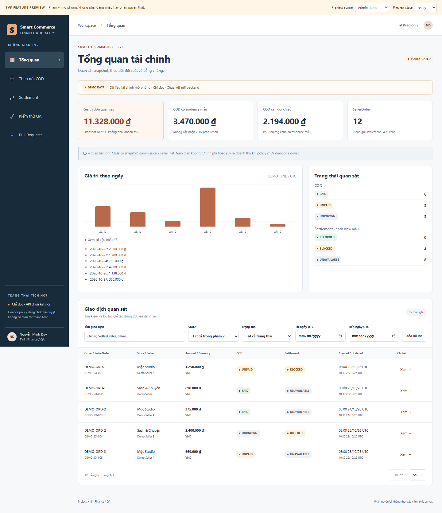
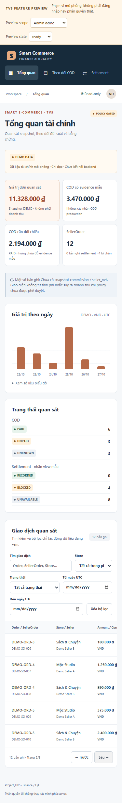
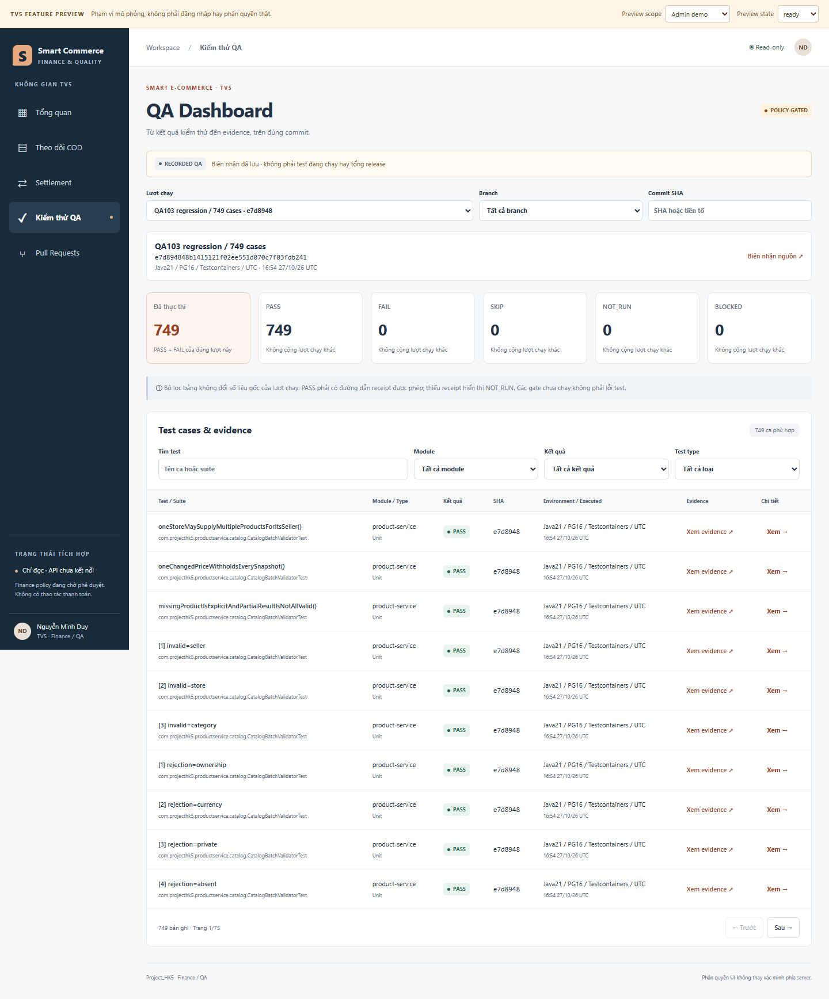

# TV5 frontend acceptance — 28/10/2026

Refs #5/#12 · [PR115](https://github.com/duyxl56785/Project_HK5/pull/115) · branch `codex/tv5-finance-qa-ui`.
**Read-only feature UI implemented and verified; API/runtime/owner integration remains PARTIAL.**
Base `91e1a6c2cc2e2f08dfb905386ba21e4d34668bf6`. Final acceptance source `9d62365a76f59ee40deff1d3d8df79c11f1b7e1b`.

## A. Frontend implemented

| Screen | Functions | Source | Verification | Status |
|---|---|---|---|---|
| Finance Dashboard | observation metrics, exact VND, chart+accessible values, COD/settlement distribution, search/Store/status/UTC date/pagination/detail | [TransactionViews](../frontend/src/features/finance/TransactionViews.tsx) | model/SSR/Chrome/screenshot | VERIFIED isolated DEMO |
| COD Management | separate delivery/payment/evidence, filters/details; no payment confirmation | TransactionViews.tsx | SSR+Chrome | VERIFIED isolated DEMO |
| Settlement | record/snapshot/date/blocker detail, supplied commission/net only; no write controls | TransactionViews.tsx | SSR+Chrome | VERIFIED isolated DEMO |
| QA Dashboard | per-run/head results, all five result statuses, module/type/branch/SHA filters, case/error/evidence detail | [EvidenceViews](../frontend/src/features/finance/EvidenceViews.tsx) | model+Chrome | VERIFIED RECORDED receipts |
| PR/Reviewer Dashboard | existing CLI projection, requested/effective/stale-head review, CI, mergeability, threads, search/status filters, GitHub links | EvidenceViews.tsx | parser+Chrome | VERIFIED RECORDED snapshot |

Same existing React19/TypeScript/Vite package; no new UI library/application. New source is entirely `frontend/src/features/finance/` plus TV5 QA/report documents. Shared App/router/Auth/API client/global styles and TV1–TV4 features/backends are untouched. Production route remains placeholder: owner integration is deliberately separate.

Run inside `frontend`: `npm run dev -- --host 127.0.0.1`, open `/src/features/finance/preview/index.html`.
Local review server prepared at [TV5 feature preview](http://127.0.0.1:5185/src/features/finance/preview/index.html), while the local session remains running. It is not a deployment. Default component adapter is blocked and default scope denied; fixtures are supplied only by the explicit preview entry.

## B. Reusable components and lifecycle

| Component | Purpose | File |
|---|---|---|
| DashboardStatCard / FinanceSummary | observation cards, no revenue/fee policy | components.tsx / TransactionViews.tsx |
| StatusBadge | text plus color; never merge UNKNOWN/NO_CHECKS into PASS | components.tsx |
| FilterBar / DataTable / Pagination | labelled controls, literal combined filters, semantic scrollable table, clamped pages | components.tsx |
| DetailPanel / DetailFields | explicit safe fields, Escape, focus trap/return; no raw-object serialization | components.tsx |
| StatePanel | loading/skeleton, empty, sanitized error/retry, permission denied, API blocked | components.tsx |
| EvidenceLink / SnapshotNote | safe project evidence links and source/boundary labels | components.tsx |
| FinanceWorkspace / WorkspaceView | read adapter lifecycle and isolated presentation | FinanceWorkspace.tsx / WorkspaceView.tsx |

Money remains exact strings; BigInt aligns scales before summation. No Number/float money, implicit FX/currency default, rounding,5%/House calculation or invented net. Chart converts only a bounded integer percentage to geometry. Historical fractional snapshot digits remain byte-exact in formatting; this is not an approval of fractional VND Product input. Missing commission/net shows unavailable.
Scope is enforced before summary/filter/options/detail display; Store mode hides QA/PR. Tests verify late old-Store responses are ignored, source changes clear stale data even for adapters sharing the same ID, denied scope prevents reads, and synchronous/asynchronous dependency errors sanitize into error state. These are UI defenses, not proof of server authorization.

## C. Executed tests and TDD

| Suite | Source | PASS | FAIL | SKIP | Evidence |
|---|---|---|---|---|---|
| TV5 model+render+DOM acceptance |9d62365 |46 (29model+11SSR+6DOM) |0 |0 |[receipt](evidence/tv5-ui-20261028/acceptance-unit-render-dom.json) |
| TV5 actual Chrome workflows |9d62365 |18 |0 |0 |[receipt](evidence/tv5-ui-20261028/acceptance-browser.json) |
| Existing Cart/Checkout/Catalog/Seller unit+SSR regression |6c74f05 |85 |0 |0 |[receipt](evidence/tv5-ui-20261028/existing-feature-regression.json) |
| Typecheck |candidate full UI |exit0 |0 |N/A |[receipt](evidence/tv5-ui-20261028/final-typecheck.json) |
| Existing application production build (includes tsc-b) |9d62365 |exit0 |0 |N/A |[receipt](evidence/tv5-ui-20261028/acceptance-app-build.json) |
| Feature preview production bundle |9d62365 |exit0 |0 |N/A |[receipt](evidence/tv5-ui-20261028/acceptance-preview-build.json) |
| Lint |No repository lint script/config |NOT_RUN |— |— |No linter disabled or fake lint PASS |
| Protected Finance HTTP / actual COD / settlement / live E2E |No signed API/runtime integration |NOT_RUN / BLOCKED |— |— |Separate owner/business gates |

**64 new frontend cases on one exact source;85existing cases are a separate regression on6c74f05, not a cross-HEAD release total.** The QA screen's historical749/32 are imported records, not new frontend test executions and not added to these totals.

Four actual TDD/repair traces, with raw original logs and source hashes preserved:

| Requirement | Actual RED | GREEN / refactor | Receipt |
|---|---|---|---|
| Exact-money/scope/QA/PR model |26FAIL from explicit unimplemented model |26PASS after implementation;26PASS refactor |model-red/green/refactor.json |
| Five-screen/state rendering |10FAIL+1alreadyPASS (absence-of-mutation case) |intermediate10PASS/1FAIL then11PASS; component extraction stays verified |component-red/green/green-final.json |
| Accessible select names |13ChromePASS/5FAIL: native label included options, exact names missing |UI aria-label fixes, same18assertion cases allPASS |browser-first/green.json |
| Sync dependency failure |5DOMPASS/1FAIL from uncaught synchronous exception |async boundary sanitizes both sync throws/rejections;6PASS, cleaned act harness |hook-red-sync/green-sync.json |

Three additional canonical LF/CRLF/U+2028 money cases passed immediately; **REGRESSION_PASS**, no fabricated RED and no formatter change. The experiment directory is named `canonical-money-red` but its actual receipt explicitly shows29PASS and explains the intended-vs-observed distinction.
Initial model-green log contains Vite dependency-scan shutdown warnings (tests26PASS/exit0); refactored test server disables dependency discovery for focused SSR. Initial hook regression included React act warnings; async act wrappers removed them without suppressing console. Initial preview bundle exceeded500k warning; dynamic imports split recorded QA288.91k, main260.02k and PR12.12k without raising/suppressing the warning threshold.

Raw logs remain local/private and byte-preserved; published [derived receipts and raw hashes](evidence/tv5-ui-20261028/raw-integrity.json) trace command, UTC timestamps, exit code, platform, Node version, source manifest and SHA256. Pre-commit candidates are labelled candidates, not falsely assigned a future exact-head test run. Publication-only commits preserve tested UI source blobs. No raw credential/log/XML publication.

## D. API integration and data provenance

| UI | Current source/API | Status | Blocker |
|---|---|---|---|
| Finance | explicit typed synthetic transaction fixtures | DEMO / BLOCKED_API_INTEGRATION | No approved Finance read API/current authority |
| COD | fixture delivery/payment/evidence, no write | DEMO / BLOCKED_API_INTEGRATION | TV4/TV3 trusted COD source, TV1 current ADMIN/Store authority |
| Settlement | supplied nullable view snapshots, blocked examples | DEMO / BLOCKED_API_INTEGRATION | Full M01/snapshots/COD/settlement policy and read contract |
| QA | selected immutable published QA receipts | RECORDED / no live API | Future safe report-serving endpoint separate |
| PR | CLI100/113 public-field snapshot,20OPEN at embedded timestamp | RECORDED / no browser GitHub API | Explicit export refresh, not live claims |

`recorded/provenance.json` links original immutable sources/digests. JSON lives under tracked `recorded/` because root runtime policy ignores `data/`; no root ignore edits. All relative imports were [checked against tracked Git files](evidence/tv5-ui-20261028/tracked-imports.json). The first draft temporarily lacked the ignored JSON files;6c74f05 versioned the sanitized records and corrected import paths before acceptance/Ready publication.
PASS without a safe receipt becomes NOT_RUN; incomplete/erroneous PR audit fails closed without usable rows. Safe links are restricted to HTTPS GitHub Project_HK5 paths, no credentials/query/foreign host/javascript. Recorded imports are trusted, reviewed projections; safe URL validation is not a cryptographic verification of arbitrary future backend evidence.

Finance records are synthetic and prominently DEMO DATA, QA/PR sources prominently RECORDED. RECORDED/BLOCKED settlement and VERIFIED/UNVERIFIED/UNKNOWN evidence labels are local view projections, not a new signed persisted enum/API. Actual delivery names mirror the isolated SellerOrderLifecycle vocabulary; no runtime integration inferred. No Create Settlement, Approve Settlement, COD confirmation, Release Payment or Refund action exists.

Product price MD01/MD02/unit-capMD03 approval remains independent. Full M01/Finance/COD/House/refund/settlement and revenue group MD10 policy remain PENDING/BLOCKED. No flags, fee defaults, business signatures, migration or backend owner changes.

## E. Commits and branch

| Commit | Change | Branch / PR |
|---|---|---|
|fab892f |exact-money/scope/receipt/PR models and26TDD cases |codex/tv5-finance-qa-ui /115 |
|12fa72c |five read-only views and reusable components, preview and tests |same |
|6c74f05 |accessible labels, fail-closed sync errors, tracked sanitized JSON, lazy record loading and README |same |
|9d62365 |3additional canonical money regressions and visual skip-link refinement |same |
|documentation publication |this report, derived receipts/screenshots and QA/RTM append only |same |

Pushes verified; no main push, force push, owner branch modification, merge or self-approval. Original root WIP `.vs/` and `reports/tv5-m01-local/` preserved. Local dependencies/build outputs/raw logs remain ignored and excluded. Existing package.json/config/lockfile conventions unchanged.

## F. Reviewers / next action

| PR | Reviewer | State at handoff | Next action |
|---|---|---|---|
|115 |lexuanbao258-collab (TV1) |REQUESTED |Review isolated frontend, then separately approve shared router/Auth/client integration mapping |
|115 |duyxl56785 (TV2) |REQUESTED |Default peer review, test/provenance/UI conventions; no duplicate request |
|115 |TV3/TV4 |No new wire/backend change requested |Provide/confirm Finance/COD read sources and future consumer contract when appropriate |

## G. Remaining work and acceptance gates

| Work | Owner | Blocker | Completion condition |
|---|---|---|---|
| Review this isolated UI |TV1+TV2 |WAITING_REVIEW |Formal owner review of source/evidence at current head |
| Main navigation/routing/Auth integration |TV1+TV5 |Shared UI105/current-authority readiness |Owner-approved integration task; no preview scope used as authority |
| Finance/COD/settlement read API/schema |TV5+TV3/TV4, TV1 security |BLOCKED_API_INTEGRATION |Signed DTO/source/security/Store scope, live positive and negative tests |
| Full money/commission/House/COD/refund/settlement policy |Business approver+TV5+TV1/TV3/TV4/TV2 as applicable |PENDING business/owner decisions |Explicit signed version and authority; no inference from this UI |
| Live protected API/E2E and deployment |Owners+TV5 QA |No integrated approved environment |Separate actual tests; never relabel fixture Chrome as live E2E |
| Shared lint/lockfile/CI frontend setup |TV1 |Repository lacks configured linter/lockfile/frontend CI |Owner-reviewed infrastructure change, not bundled in this feature |

- [x] Five pages, reusable UI, typed blocked adapter and explicit demo/recorded sources.
- [x]64new frontend cases GREEN at9d62365;85old-feature regression retained separately.
- [x]Typecheck/application build/preview build run; secrets/diff/tracked-import packaging checked.
- [x]Actual Chrome responsive375/768/1440, labels, modal focus/return and visual screenshots inspected. Basic checks, not a full WCAG/axe certification.
- [ ]Owner review/main routing and real read API/current authority.
- [ ]Full Finance/COD/settlement production and live E2E acceptance.
- [ ]Issue5/12DONE: still OPEN/PARTIAL; frontend delivery does not satisfy all F15/F16/week1 acceptance gates.

Screenshots from exact9d62365 acceptance, unedited and synthetic/public-data only:

